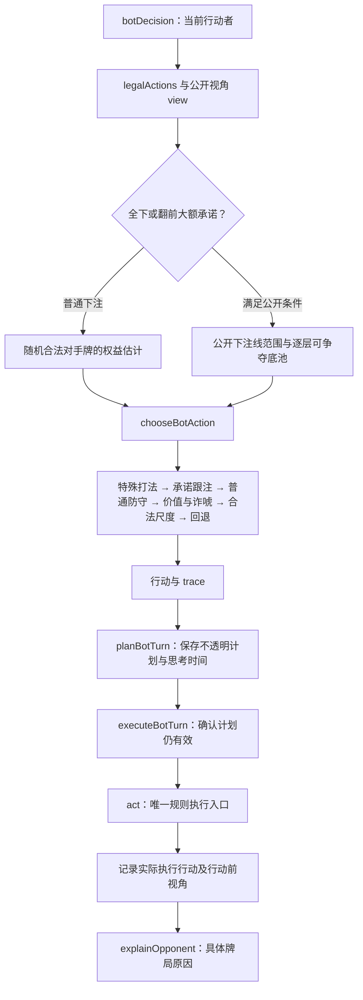

# 机器人决策与复盘逻辑审计（2026-10-14）

本文记录本轮源码审计的调用链、分支条件、已修复问题和证据边界。机器人采用有公开信息约束的训练启发式；本文不把它称为 GTO 求解器，也不把配置概率称为真实牌手的实战频率。测试入口与已运行结果分开记录，最终交付验证由主任务补充。

## 决策调用链与信息边界



入口在 `src/engine/poker.js` 的 `botDecision`。它先向同文件的 `legalActions` 取得可行动作，再评估自己的底牌与当前公共牌。传给策略的 `view` 是明确列举字段的行动者视角：自己的底牌、当前牌面、位置与当前相对位置、筹码、已经投入的金额、当前底池、合法跟注及加注边界、未弃牌人数、其他人的公开筹码与全下状态、此前公开行动和自己的牌面特征。

其他玩家的底牌、后续牌堆、最终赢家、复盘评级不进入这个视角。估计器从完整标准牌组排除自己的底牌和当前公共牌后，生成假设对手牌及假设后续公共牌。这些样本不是实际对手底牌，也不是实际将要发出的牌。改变隐藏底牌或未来牌堆而保留相同公开视角，不应改变同随机种子的机器人决策。

`view.rivals` 包括所有尚未弃牌的对手。普通随机估计仍会把这些人作为随机对手，因此它是粗略训练估计。面对全下或满足条件的大额翻前再加注时，另走公开下注线模型，避免把所有尚待行动的座位都当成已经跟入摊牌。

## 普通权益与大额承诺权益

### 普通下注

`estimateEquity` 估计自己的牌对随机合法对手牌能分得多少底池。`chooseBotAction` 再加入按难度设定的判断扰动、跟注倾向及有限的公开行动修正。起手牌排序、位置入池范围与再加注范围是手工控制的训练规则；“高牌力档位”并不证明面对当前下注有正收益。

小投入平跟、小开池防守、小尺度 3-bet 防守有单独范围入口，避免直接拿“所有未弃牌玩家一起摊牌”的粗估值否定正常的小额入池。它们有金额、投入占比、位置、加注次数和对实际加注者的有效后手限制，不能用于大额全下防守。

### 全下或翻前大额承诺

`src/engine/bot-allin.js` 的 `allInContext` 要求当前确实需要付费跟注，且本街最后进攻者仍是公开视角中的对手。以下任一条件成立才进入此模型：

- 实际进攻者已经全下。
- 当前跟注会用完行动者的后手。
- 翻前本街至少已有两次加注，需匹配的总下注至少为 1,000（当前 50 大盲的 20BB），新增跟注至少占自己后手的 35%。这是大额承诺条件，不等于已经全下。

`isAllIn`、`aggressorAllIn`、`callerAllIn` 与 `highCommitment` 分开保存。留下部分筹码的大额 4-bet 不应绕回“强起手牌直接继续”分支，也不能在复盘里被描述为进攻者已无法继续下注。

模型把实际进攻者、已经跟到当前金额的人以及此前全下的人列为 `committed`。其他人是 `waiting`：其已经投入的筹码属于底池，但不凭空增加未来跟注，也不直接分配一手已确认的摊牌牌。待行动者只增加有上限的风险缓冲；此前加注者的缓冲比普通待行动者更大。

范围权重依赖公开下注线、有效深度和角色：例如短码全下、深码冷全下、多次翻前再加注，以及已经接住大额下注的跟注者。翻后权重还区分自己的真实成牌、顶对或超对、听牌及少量诈唬。它是人工范围模型，不是从真实牌手样本拟合出来的频率。

### 逐层底池、退款与确定保本边界

`botDecision` 使用现有 `partitionPots` 分别计算跟注前后的公开投入账本，取得行动者可争夺的各层底池。全下评估的风险金额为：

```text
新增风险 = 实际需拿出的跟注金额 - 本次新增未跟注退款
需要的权益比例 = 新增风险 / 跟注后自己有资格争夺的底池总额
```

其他人的底牌与最终赢家都不参与这一步。短码全下者只参加其有资格争夺的主池，不参加后来形成的更高边池。此前短码全下的范围保留当时的公开下注线及街次，不因为另一位深码玩家的新下注被误当成刚刚深码全下。

河牌另有确定规则边界：枚举所有合法未知底牌，若没有任何组合能击败自己的当前牌，则记录 `unbeatableRiver`。保守的最少返还额逐池按所有已有资格座位平分，**每池先向下取整到 25 筹码，再求和**；不预支可能得到的余筹。只有该下界覆盖本次新增风险，才排除噪声造成的错误弃牌。公共皇家同花顺与私有河牌坚果牌属于此边界。真实派彩、退款及余筹分配仍由规则引擎执行，这个下界不是提前写入的结算结果。

## `chooseBotAction` 的实际优先级

| 顺序 | 条件或分支                                         | 执行与限制                                                                                                                                    |
| ---- | -------------------------------------------------- | --------------------------------------------------------------------------------------------------------------------------------------------- |
| 1    | 读取 profile、情绪模式、位置、公开行动及合法动作   | 情绪只修正训练轴；不读取隐藏牌，也不改变规则权限。                                                                                            |
| 2    | 计算起手牌排序、入池范围、再加注范围、小额防守入口 | “允许入池”和“主动再加注”是两个范围，避免平跟牌自动反复再加注。                                                                                |
| 3    | 计算 float、听牌继续、对子继续、半诈唬和纯诈唬候选 | 候选仍需通过后面的价格、攻击抽样和合法尺度条件。候选为真不代表已执行。                                                                        |
| 4    | `deceptiveAction` 特殊打法                         | 强牌埋牌优先，然后 2–7、脏牌开池或再加注、donk。自身安全条件先限制大额风险。                                                                  |
| 5    | 公开大额承诺防守                                   | 权益加跟注倾向低于“真实成本赔率 + 待行动风险缓冲 + 2 个百分点”时弃牌；确定保本河牌例外。继续时执行跟注，不能因旧 premium 标签制造边池再加注。 |
| 6    | 普通范围、价格与筹码压力检查                       | 不在范围且价格并不便宜时可弃牌；不受小额防守、听牌或其他有效支撑保护时，再检查权益与投入压力。部分低频错误由训练难度及轴控制。                |
| 7    | 没有加注权限                                       | 只从引擎给出的过牌或跟注选项继续，不把强制跟注解释为主动埋牌。                                                                                |
| 8    | 价值、薄价值、小持续下注、控池、基础埋牌           | 翻后价值与薄价值必须有自己贡献的成牌，不能只借公共对子与偏高随机权益。控池可以是高牌，不统一叫中等成牌。                                      |
| 9    | 攻击选择与尺度                                     | 只有价值、半诈唬、纯诈唬、小持续下注或薄价值候选且攻击抽样选中时提出下注；最后按引擎边界取合法 25 档位。                                      |
| 10   | 回退                                               | 诈唬是唯一价格支撑却没有真正执行加注时，不能意外回退为低权益跟注。其余按实际支撑选择过牌或跟注。                                              |

普通翻前 premium 仍能支持小额防守；本轮修复是在它前面加入真实大额承诺成本判断，而非把所有强起手牌的一般防守删除。

### 成牌与补牌事实

`botBoardFeatures` 区分 `ownMade`、`ownTwoPair`、`strongMade`、`ownPair` 和 `playsBoard`。自己的底牌必须对成牌实际有贡献。例如：

- 44 在 Q Q A 7 2 上的“最佳五张两对”，不能当成自己做出的强两对。
- AK 在公共三条 9 的牌面上，不能仅凭公共三条进入强牌价值分支。
- 22 在 J J 9 9 K 上不能把公共两对当成自己的价值成牌。
- K7 在 K 7 3 上的两对、55 在 5 K 9 上的暗三条，属于真实私有强成牌。
- 公共四条的牌面上，自己的 A 踢脚若确实提升最佳五张，仍可以构成有实际贡献的牌力；不能一概把所有公共四条都判为完全打公共牌。

听牌候选用实际未见卡片集合求并集。Q♠ J♠ 在 T♠ 9♦ 2♠ 上，9 张同花补牌与 8 张顺子补牌有 2 张重叠，合计 15 张候选，不是只取较大的 9 张，也不是直接加成 17 张。这些是可能改善牌型的卡片，不保证补中后获胜；对子牌面和多人底池另有折扣。

公共牌补成相同顺子不算自己的独立顺子听牌。7–2 在 9 T J Q 上不能把补 8 说成自己的 8 张顺子补牌。复盘的 `context.drawInfo` 同样需要排除等值底牌被 evaluator 选入、实际上公共五张已成相同牌的情形；同花补牌重叠成同花顺也不能重复描绘成一组额外的独立卡顺。

`nearAllInDraw` 是很窄的边界：仍非全下跟注，自己有真实补牌，本次跟注后只剩至多一个 25 筹码，且**把全部后手计入风险**后价格仍得到折扣补牌率支持。剩 50、实际价格太贵、只有公共牌听牌或面对实际全下承诺模型时，不由这个入口保护。它不等于“有听牌总能跟”。

### 价值、诈唬与控池

翻后普通价值需要 `ownMade`、不是完全打公共牌，并满足相应权益阈值。薄价值限有位置的单挑河牌、能免费过牌、相对干燥牌面和中间权益区间。顶对的实际价值 donk 应说明让较弱成牌付费，不能因为并非两对就误称没有牌力的诈唬。

半诈唬要求真实听牌、合法加注权、有限对手人数及投入压力，不能向已经全下的唯一对手继续制造弃牌率。纯诈唬需要能解释的公开下注线、低投入压力与范围或阻断条件；河牌阻断来自自己的底牌及公共牌。多条街的主动权沿最后一次公开加注者保留，服务于持续下注和继续施压，不是要求每街重新出现一次加注。

有位置小额 float 保留了下一街对手放弃进攻后主动下注的可能。现有 float 还要求单挑且没有全下对手。本轮检查发现“一个短码全下者 + 一个能行动的深码对手”本来就不符合单挑条件，因此没有为了未经证实的边池 float 人为放宽限制。

控池由单挑、可以过牌、干燥牌面、没有听牌以及中间权益估计等条件决定。当前牌可能仍是高牌，复盘应说当前牌力与保留摊牌机会，不能凭分支名字断言已经有一手中等成牌。

## 特殊打法的条件与执行含义

`deceptionPolicy` 取 profile 的基础轴而非情绪轴。新增组合在初级难度为零，标准难度倍率为 1，高级为 1.8，并保留各条件与上限。均衡 profile 可以参与；其他 profile 需具有相应的埋牌、宽范围、进攻或诈唬特性。这是**满足条件时的训练选择概率**，不是整手发生率，更不是某位真实牌手的公开统计。

| 打法             | 必要公开条件                                                                              | 防止误称或无根据冒险                                                                                                                         |
| ---------------- | ----------------------------------------------------------------------------------------- | -------------------------------------------------------------------------------------------------------------------------------------------- |
| 翻前强牌平跟埋牌 | AA/KK、单次小开池至多 200、仍有加注权、付费很小、至多两位对手、实际开池者与自己有足够后手 | 有其他深码玩家不代表当前浅码开池者足够深；没有加注选择的强制跟注不是主动埋牌。                                                               |
| 翻后强牌埋牌     | 自己真实强成牌或符合条件的强超对、单挑、干燥牌面、有效后手至少两倍底池                    | 付费埋牌限河牌前、仍有加注权且小价格；河牌过牌诱导必须无位置且唯一对手本街尚未行动。末位过牌直接进入摊牌不能称诱导下注。                     |
| 2–7 诈唬         | 后位未开池偷盲，或翻后单挑有位置、对手已过牌、干燥牌面、自己仍为无听牌高牌                | 没有 2–7 奖励机制，不是悬赏全下；已成牌、多人大底池或大额风险不作为此特殊诈唬。                                                              |
| 脏牌开池         | 非对子、非 2–7 的低张大间距牌；后位未开池，无前面跟入者，人数有限                         | 同花 A 等可玩牌不按此脏牌定义处理；不是允许任何差牌无条件开池。                                                                              |
| 脏牌再加注       | 单次小开池、后位、没有跟注者、自己有 K/A 高牌阻断、付费很小                               | 阻断仅来自自己的牌，不知道对手实际持有什么。                                                                                                 |
| donk 主动领打    | 翻牌或转牌、无位置、前一街实际进攻者仍在且有筹码、本街尚未行动、自己可免费过牌            | 自己或前进攻者已行动、本街已有人加注、前进攻者退出或全下则不按此定义；其他座位先过牌不取消真正领打。特殊 donk 还需单挑真实强牌或湿面强听牌。 |

特殊下注提案同样通过 `legalRaiseTo`；不会主动做到最大全下，新增投入不超过有效筹码的 15%，且有效后手至少 1,000。基础策略也可能做出符合公开行动定义的 donk，记录 `source: base-policy` 及实际价值、半诈唬或诈唬类型。不能把“特殊选择器没有选中”理解为整套策略不可能做出此动作。

## 合法金额、执行与 trace 的解释

`src/engine/bet-sizing.js` 只把策略提出的金额映射到引擎给出的合法最小、最大加注额以及 25 筹码档位。常规翻后尺度先按“底池 + 需跟金额”计算加注增量，再加当前下注总额。纯空气诈唬不能因最小合法尺度夹到最大额而意外全下；真正价值、薄价值或半诈唬候选另按合法边界处理。

合法权限、短全下后是否重开加注、投入、退款、主池及边池资格、结算、余筹仍由 `poker.js` 的 `legalActions`、`act`、`partitionPots` 和 `settle` 唯一负责。策略产生一个动作不构成“规则一定允许”的证明；执行器仍需验证当前计划并调用规则入口。

`planBotTurn` 保存行动前决定和思考时间的不透明计划。`executeBotTurn` 确认当前游戏、手数、重试次数、行动人、街次、行动序列、难度、筹码及下注仍匹配后才执行；不重新抽样策略。仅成功执行后把动作、金额及行动前 `trace.view` 写入 `g.botDecisions`。本轮没有改写计划取消、下一手、重试或结算撤回机制。

trace 的读取顺序应为：**实际 `action` / `amount` → 最终 `reason` → `sizing.executed` 与实际 deception → 当时的 view 与相关计算条件**。其中：

- `value`、`semiBluff`、`pureBluff` 或 style 候选可能先为真，但最终没有执行进攻，不能直接拿候选当最终动机。
- `checks.selected` 对范围、权益与筹码压力检查记录的是低频继续例外是否选中，不能误读成“选择弃牌”。
- `equityModel` 明确区分随机对手、公开全下范围与公开大额承诺范围。后者不自动表示实际全下。
- 原始估计、扰动、抽样次数、阈值与思考因子用于内部检查；当前对手复盘不把它们堆成参考数字模块，不展示 EV。

`explainOpponent` 按实际行动前底牌、公共牌、面对谁的何种下注、金额、当前成牌及听牌、可争夺底池和后手解释。牌型比较给出当前牌面上合法的较弱及较强示例，不宣称它们就是实际对手范围。成牌加听牌的全下跟注应同时交代已有摊牌价值与补牌机会；纯听牌弃牌与成牌弃牌不能混用理由。

当前跟注若把自己全下，之后只能等公共牌和摊牌；唯一对手已经全下时，弃牌理由不能再说后续还会被他持续下注。仍有筹码的其他玩家后来跟入时，才有继续争取边池的空间。英雄复盘始终用自己的行动前公开快照评级，后续真实公开回应单独展示，不反向改变评级。

## 本轮已确认问题与修复

| 问题                                               | 原因与修复                                                                                       | 对应边界入口                                                                            |
| -------------------------------------------------- | ------------------------------------------------------------------------------------------------ | --------------------------------------------------------------------------------------- |
| 凌空全下后，开池者或有强牌者几乎一律弃牌           | 随机模型把尚待行动座位当成已进入摊牌；大额线改为 committed/waiting 区分及公开范围估计。          | `bot-allin.test.js`：待行动者、翻牌超对、冷全下及多次再加注。                           |
| 某些起手牌档位又能无视大额价格自动继续             | 普通 premium 防守绕过当前大额风险；公开承诺价格分支前置，强牌需面对实际范围与成本。              | 同文件：AA/KK 的防守、77/AQ 等并非必接、已存在大额跟注者的多人底池。                    |
| 接近全下的大额 4-bet 与真正全下行为突变            | 仅用 all-in 标志选择模型；加入有限的大额翻前承诺条件，保留真实全下标志。                         | 同文件：4,000 与 5,000 下注相邻边界及非全下复盘。                                       |
| 赔率错把不能赢的层计入，或忽略新增退款             | 使用公开账本复用 `partitionPots`，按行动者资格计算每层与退款差额。                               | 同文件：短码封顶、先前短全下的主池、后续深码边池、退款。                                |
| 公共皇家同花顺等不会输的河牌仍可能受噪声影响弃牌   | 合法未知底牌穷举与逐池 25 筹码保守返还下界优先于抽样。                                           | 同文件：公共皇家同花顺、私有河牌坚果、逐池取整与筹码守恒。                              |
| 借公共对子、公共两对或三条被说成自己的强牌         | `ownMade` / `ownTwoPair` / `strongMade` 区分实际底牌贡献，价值与范围权重共同使用。               | `bot-features.test.js`：公共牌与私有成牌对照。                                          |
| 组合听牌少算或重复算补牌                           | 顺子与同花候选使用唯一未见卡片并集，15 候选边界保留；只剩 25 的小价格继续另有全后手价格限制。    | 同文件：15 候选、公共顺子伪听牌、剩 25 正例及较贵/剩 50 反例。                          |
| donk、强制跟注、河牌末位过牌的标签失真             | donk 检查仍可行动的真实前街进攻者；平跟埋牌必须仍可加注；河牌诱导要求对手尚未本街行动。          | `bot-deception.test.js`：前进攻者退出、他人先过牌、强制跟注、浅码开池者、河牌行动顺序。 |
| 思考时间沿用旧范围边界或付费总额而非风险           | 承诺模型使用实际赔率与待行动缓冲；确定保本不标疑难；风险用净新增成本，后手规划仍用实际拿出金额。 | `bot-timing.test.js`：pending buffer、确定保本、净风险为零及后手不变。                  |
| 全下后的复盘仍虚构后街下注，成牌加听牌只被说成买牌 | 按实际全下者与跟注者状态解释终端空间；先说明成牌摊牌价值，再补真实听牌事实。                     | `bot-review-boundaries.test.js`：实际 77 成牌加同花听牌跟注与 Q♠7♠ 听牌弃牌。           |
| 高牌控池被统一叫中等成牌                           | 使用当前手牌标签，不从策略名字推断已成牌。                                                       | 同文件：实际高牌控池 trace。                                                            |
| 最后新增事实句有库存却没有在复合段落翻译           | 短句固定字符少于 localizer 的 fragment 最小长度；使用等义的较长固定前缀，并读审真实复合输出。    | 同文件及 `.artifacts/terminal-review-locale-audit.json`。                               |

## 思考时间与行为证据边界

`botThinkingTime` 只接受决策视角，使用当前价格接近程度、牌面、自己的听牌、公开下注线、位置、剩余有效筹码、SPR 和投入压力生成 1,200–8,000ms 的训练节奏。策略随机与时间随机分开；调时间不能重选动作。高级难度的较复杂决定不代表每次都慢，随机表演也覆盖价值、诈唬、埋牌和弃牌，不能据停顿判断底牌。

情绪、profile 轴、随机范围权重、候选补牌折扣、跟注缓冲、攻击概率、行动节奏属于启发式。当前牌型比较、合法动作、实际公开投入、逐层资格、合法未知河牌组合无可击败者以及 25 筹码结算属于确定事实或规则边界。不能把启发式选择解释成已证明的最优动作或真实牌手心理。

## 验证记录与交付补充

以上表格列的是实际可复现的测试入口，**测试存在不等于本轮执行通过**。本轮辅助文件修复的针对性执行记录包括 slow-play、donk、承诺价格思考边界、确定保本思考边界和净跟注风险边界；保留日志为 `.artifacts/bot-deception-timing-final.log`。此前的大量随机混合样本、完整多手回归没有因这些辅助修复重新全部运行。

最终 i18n 库存为 1,457 条，十个非简体中文 locale 已补齐本轮新增与替换文案；覆盖率和变量守恒分别检查，不能据此宣称十种语言已经经过独立母语德州专家认证。`translation-provenance.json` 明确保留该语言审校限制。实际全下成牌加听牌、听牌弃牌及控池输出需以最终源码生成记录核对。

主任务将在交付时补充最终实际运行的 unit / Web 定向场景、构建、原生编译或安装运行证据。本文不把浏览器通过、源码检查、字体覆盖或原生编译单独当成 iOS/Android/微信设备运行通过，也不声称全面回归或远端 CI 已通过。
