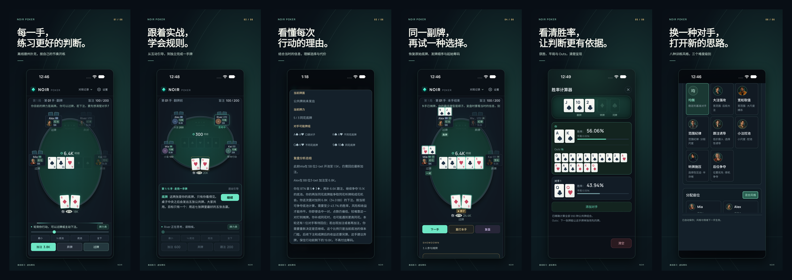

# NOIR Poker 商店素材工作室

独立的 Remotion 4.0.541 工程。素材以 PR #70 的 `38337032eacf30eae24fdeb00da07451b1e7a099` 为依据，录制正常安装包，不注入牌局、隐藏牌或测试 fixtures。不会进入 Web、App 或微信的正式包。



[英文截图概览](previews/en.png) · [验收记录](VALIDATION.md)

## 安装与预览

需要 Node.js 22.13+（或 24+）和 FFmpeg/ffprobe。在本目录执行 `npm ci`，然后 `npm run dev -- --no-open --port=4390`。交付的源文件包已经包含 `public/assets`、`public/media` 和 `public/voice`；Git 中不保存这些较大的派生文件。仅从 Git 恢复时先在仓库根目录安装依赖、执行 `npm run mobile:sync`、编译两端，然后运行本目录的 `node prepare-brand.mjs` 并重新采集。

`src/Root.tsx` 注册苹果竖屏视频、Google Play 横屏视频、两种语言的有旁白和音乐版本、iPhone/iPad/Android 截图与 feature graphic。每支完整视频为 29 秒、30 fps，五段依次为练习、引导、复盘、原牌重打与胜率计算。转场重叠 12 帧，实际起点为 0、5.6、11.2、17、22.6 秒。

`storyboard.json` 保存分镜和旁白稿；`src/StoreFilm.tsx` 控制画面、字幕与音轨；`src/StoreStill.tsx` 控制截图版式。修改旁白文本后同步更新对应字幕文本。音频由 macOS 系统语音 Samantha / Tingting 合成，另交付无旁白版本。字幕 JSON 与 SRT 也会单独导出。

## 重新采集原生素材

先按仓库 `docs/native-e2e.md` 准备本地 Appium 工具与**专用测试设备**。标准采集会卸载/重置所选测试 App，不能指定正在使用的个人设备。所有截图由原生驱动取得，视频由所选 Simulator / Emulator 的系统录屏取得。只读取公开状态判断操作，行动仍使用界面控件。

```sh
node capture-native.mjs ios --udid DEDICATED_IOS_UDID --port 4764 --driver-port 8864 --output ../.artifacts/store-media/raw/ios
node capture-native.mjs android --udid DEDICATED_ANDROID_SERIAL --port 4766 --driver-port 8866 --output ../.artifacts/store-media/raw/android
NOIR_STORE_STILLS_ONLY=1 node capture-native.mjs ios --udid DEDICATED_IPAD_UDID --port 4768 --driver-port 8868 --output ../.artifacts/store-media/raw/ipad
node prepare-media.mjs ios ../.artifacts/store-media/raw/ios
node prepare-media.mjs android ../.artifacts/store-media/raw/android
node prepare-media.mjs ipad ../.artifacts/store-media/raw/ipad
node prepare-voice.mjs
```

Android 若在原生截图后重连 WebView 时阻塞，可使用独立的媒体采集入口：

```sh
node capture-android-cdp.mjs DEDICATED_ANDROID_SERIAL ../.artifacts/store-media/raw/android-webview
```

它只附着所选仿真器内已安装 APK 的 WebView，不启动桌面浏览器。使用 Playwright 的 AndroidWebView 接口操作界面，系统 `screencap` / `screenrecord` 保存实际设备画面；核对 APK 指纹、Capacitor 的 Android 原生身份、正常本地包来源和 QA fixture 缺席。该入口不进行原生可访问性树快照，截图中的系统弹窗和显示质量必须逐张肉眼核验。它不替代原有 Appium 全套 E2E、原生生命周期或真机验收。

`capture-native.mjs` 将仓库原生 runner 适配到忽略目录 `.artifacts/`，复用真实安装、源码指纹、首屏等待、原生触摸、系统错误检测和会话清理。不会修改原始 runner 或规则。`NOIR_STORE_MODE=repair` 是本次补录入口；`NOIR_STORE_RESUME=1` 保留专用设备上已安装 App 的数据，仍独立重启并等待首屏，然后才附着 WDA。补录文件可用 `NOIR_STORE_REPAIR=/absolute/path` 传给 `prepare-media.mjs`，原始失败记录应单独保留。

采集只覆盖选定核心功能，不等同于完整原生 E2E。模拟器、实体设备、签名发行包和商店审核是不同的验收范围。

## 导出与检查

```sh
node export-kit.mjs /absolute/path/NOIR-Poker-Store-Kit
node verify-kit.mjs /absolute/path/NOIR-Poker-Store-Kit
npx tsc --noEmit
npx eslint src
```

导出会在全部原生素材就绪前拒绝执行。只需图片时可追加 `--stills-only`；分阶段导出可追加 `--store=apple` 或 `--store=google`。输出已存在时默认跳过渲染，修改画面或媒体后用 `NOIR_STORE_OVERWRITE=1` 明确重新渲染。`verify-kit.mjs` 检查字段长度、图片尺寸和 RGB 通道、视频时长/编解码/帧率/音轨、完整解码以及 manifest 的 SHA-256；肉眼审阅和听感审阅须另外记录。

## 来源

- 工作流：[Remotion Agent Skills](https://www.remotion.dev/docs/ai/skills)，官方 `remotion-best-practices` v4.0.541 的创建、分镜、媒体、字幕、字体、渲染与 Studio 指南。
- 字幕基础组件：原样保留 [Basic Captions](https://www.remotion.dev/elements/captions/basic-captions.md) 的代码，通过外部样式匹配 NOIR 品牌。
- 图标、字体、角色插画、背景音乐：当前仓库已有本地资源；字体许可和音乐来源随源文件包保留。
- 采用 Remotion 自带的渲染浏览器，不依赖录屏浏览器，不上传素材到第三方生成服务。

素材规范与后台填写位置见仓库的 [商店素材说明](../docs/store-media.md)。Remotion 本身的许可见 [官方许可说明](https://www.remotion.dev/docs/license)。
