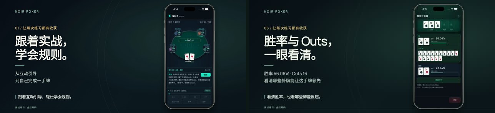

# NOIR Poker 商店素材工作室 · V5

独立 Remotion 4.0.541 工程，依据 PR #70 的 `94e56b1ef009f0729508491e5f2155fd37d2bf99`。英文与简体中文使用真实安装的 iPhone、iPad、Android App 素材。普通对局、教程、计算器和记录通过可见控件操作，没有注入牌局或测试 fixtures。



## V5 清晰度增强导出

V5 保留 V4 的所有排版、文案、分镜、时序、点按和声音。每语言增加 `master-3840.mp4`（3840 × 1772）以保留手机放大观看所需像素。两家商店继续共用 `shared-preview.mp4`（1920 × 886、894 帧、29.8 秒）。这是同一版内容的两个输出尺寸。iPhone 商店预览规格仍为 1920 × 886，高清母版用于编辑和放大观看。

清晰度处理采用原始帧的无损 WebP 序列、PNG 渲染帧、2 倍密度渲染及无损 PNG 中间序列；每个交付文件只做最后一次有损编码。商店文件由高密度无损中间片经 Lanczos 缩小，不经过 JPEG 或已压缩高清成片再压缩。录屏本身保持原样，不用生成式方法重画字或牌面。音轨从 V4 直接复制 AAC，检查两种输出与锁定音轨的哈希一致。

`src/SharedFilm.tsx` 控制两种语言共用的六镜时间线。`prepare-shared.mjs` 对原始 VFR 全片先转 30 fps，再按真实画面切换位置剪辑，避免静止画面使触点提前或滞后。坐标取自可见按钮边界，点按位置按完整屏幕的同一坐标系换算。复盘、重打、改选弃牌、下拉菜单、对局记录、选中一手都有点按提示。最后保留该翻牌面的实际计算画面，胜率 56.06%、Outs 16，与后续转牌结果区分。

`IPhoneFrame.tsx` 供视频和手机截图复用；Android 截图保留 Android 界面，iPad 使用平板外框。原配乐在旁白下面由 0.12 提升为 0.30（约 +8 dB）。沿用两种已选女声，末镜新录中文“看清胜率，也看哪些牌能反超。”和英文对应句。不再为两家各编码一份视频。

在含素材的独立工程中先 `npm ci`，然后运行：

```sh
npm run dev -- --no-open --port=4390
# Studio: /Shared-ZH 或 /Shared-EN
npm run export:clarity -- /absolute/path/store-kit-v5
npm run export:shared-stills -- /absolute/path/store-kit-v5
npm run verify:shared -- /absolute/path/store-kit-v5
```

如需重新剪原片，将原始采集目录解压后运行 `npm run prepare:clarity -- /path/to/raw --lossless-frames`；索引使用 `ios/`、`ios-en-correction/`。`public/locked-audio/` 为此次直接复制的 V4 音轨；如未来改声音，需要更新该音轨。仅重做末镜旁白可用 `npm run voice:shared`。验证程序检查单一成片的完整解码、平均视频码率、帧数、双声道、响度、峰值、图片尺寸和双语字段，并从交付 MP4 导出点击前后对照。

## V2 原生采集与旧版成片

以下为 V2 的原始采集与分平台剪辑说明。新版请使用上面的 V5 命令。


[英文概览](previews/en.png) · [体验与验收记录](VALIDATION.md)

## 预览和编辑

需要 Node.js 22.13+（或 24+）、FFmpeg / ffprobe。在本目录执行 `npm ci`，然后 `npm run dev -- --no-open --port=4390`。交付源文件 ZIP 包含实际媒体、字体、音乐和旁白；Git 只保存代码、小型概览与字段，较大的生成素材不入库。

视频均为横屏，取消竖屏成片。每支 29.8 秒、30 fps，顺序为：新手引导 → 实战与本手动态 → 从结算页点击复盘 → 点击重打并改变决策 → 对局记录与详情 → 胜率计算。转场重叠 6 帧，场景起点为 0、4.4、9.2、14.4、19.7、24.6 秒。

- `storyboard.json`：分镜、双语字幕和旁白文本。
- `src/StoreFilm.tsx`：六段独立场景、转场、字幕、界面全景/局部放大、音轨。
- `src/DeviceFrame.tsx`：无第三方标识的金属手机/平板边框。截图和宣传视频使用；实际界面像素保持原样。
- `src/StoreStill.tsx`：八项体验截图，包括新增的对局记录、记录详情。
- `src/media-plan.json`：实际原生素材路径和构建来源。

字幕使用左下固定阅读区、细薄薄荷绿标线与较轻字重，不遮住宣传版手机界面。中文采用用户试听选定的 `zh-CN-XiaoxiaoNeural` 温暖女声，英文采用 `en-US-EmmaNeural`；通过 `edge-tts 7.3.1` 生成，保留原始 MP3、文本、SRT 和 48 kHz 立体声 WAV。重打读 chóng：旁白写成“重新打同一副牌”，画面标题仍为“重打原牌”。不加速语音来硬塞时长，另附音乐版。

## 两家商店的横屏区别

Google 版为 1920 × 1080，有手机机身、品牌排版和真实 Android 录屏。上传至自己的 YouTube 后填写 URL。

Apple iPhone 预览版为 1920 × 886。依据 App Review 2.3.4，该版本只用实际 iOS 录屏及解释性字幕，并保留完整界面与同段画面的局部放大；不放宣传版的手机外壳。当前 iPhone App 锁定竖屏，横屏视频不代表 App 本身支持 iPhone 横屏，也不伪造横屏 UI。两种横屏文件按各自后台使用，不混传；商店最终审核仍独立进行。

## 重新采集

重新录制需要放回 NOIR Poker 仓库，先在根目录按 `docs/native-e2e.md` 准备本地工具、同步并实际编译两端。仅指定专用模拟器；标准入口会重置所选测试 App 数据。

```sh
node prepare-brand.mjs
NOIR_STORE_MODE=v2 node capture-native.mjs ios --udid DEDICATED_IOS_UDID --port 4774 --driver-port 8874 --output ../.artifacts/store-media-v2/raw/ios
NOIR_STORE_MODE=v2 node capture-android-cdp.mjs DEDICATED_ANDROID_SERIAL ../.artifacts/store-media-v2/raw/android
NOIR_STORE_MODE=v2 NOIR_STORE_STILLS_ONLY=1 node capture-native.mjs ios --udid DEDICATED_IPAD_UDID --port 4778 --driver-port 8878 --output ../.artifacts/store-media-v2/raw/ipad
node prepare-media-v2.mjs ios ../.artifacts/store-media-v2/raw/ios
node prepare-media-v2.mjs android ../.artifacts/store-media-v2/raw/android
node prepare-media-v2.mjs ipad ../.artifacts/store-media-v2/raw/ipad
node prepare-voice.mjs
```

可用 `NOIR_STORE_LOCALES=en` 单独补录英文；准备时用 `NOIR_STORE_EN_REPAIR=/absolute/path` 为该语言指定已成功的补录目录。补录报告与旧报告各自保留，不把失败或试剪改写为通过。

Android 使用 Playwright AndroidWebView 附着已安装 APK，系统 `screencap` / `screenrecord` 取得画面；核对原生身份、APK 和源码摘要、正常本地页面与 QA fixture 缺席。不获取会引起上下文重连的原生可访问性快照，系统弹窗和显示质量另行肉眼查看。该采集不是完整原生 E2E 或生命周期验收。

编辑依据事件标记剪去等待，重打还检测公共牌实际清空的画面时间，以保留“点击前 → 重新发牌 → 再行动”。不改变录屏速度，不重画 UI、不更改牌局、筹码和概率。剪辑明细保存在 `edit-provenance-v2.json`。

## 导出和检查

```sh
node export-kit.mjs /absolute/path/NOIR-Poker-Store-Kit-V2
node write-gallery.mjs /absolute/path/NOIR-Poker-Store-Kit-V2
node verify-kit.mjs /absolute/path/NOIR-Poker-Store-Kit-V2
npx tsc --noEmit
npx eslint src
```

默认跳过已有成片，修改画面后用新目录或 `NOIR_STORE_OVERWRITE=1` 重渲染。可加 `--stills-only` 或 `--store=apple|google` 分阶段导出。导出前必须准备全部目标原生素材。技术检查覆盖字段、8 张截图/组、RGB/尺寸、横屏视频编码/时长/音轨、完整解码及 SHA-256。画面与听感审阅另外记录。

## 来源

[Remotion Agent Skills](https://www.remotion.dev/docs/ai/skills) 的创建、分镜、媒体、字幕、字体、Studio 与渲染指南。基础字幕组件原样保留 [Basic Captions](https://www.remotion.dev/elements/captions/basic-captions.md)，用外部样式匹配品牌。图标、画面、字体和配乐取自仓库已有本地资源，许可与来源随包保留。[Remotion 许可](https://www.remotion.dev/docs/license)。[edge-tts 项目](https://github.com/rany2/edge-tts)。

商店字段与官方规格链接见 [商店素材说明](../docs/store-media.md)。不提交商店后台，不包含发布凭据、签名材料或生成的原生 Web 副本。
